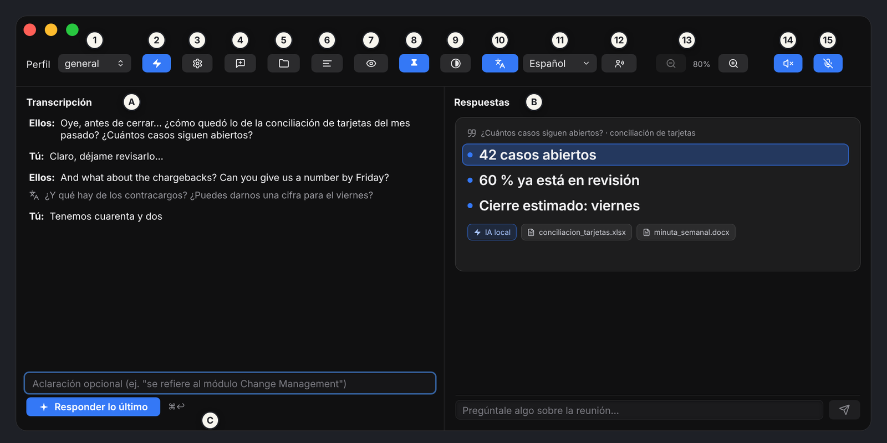
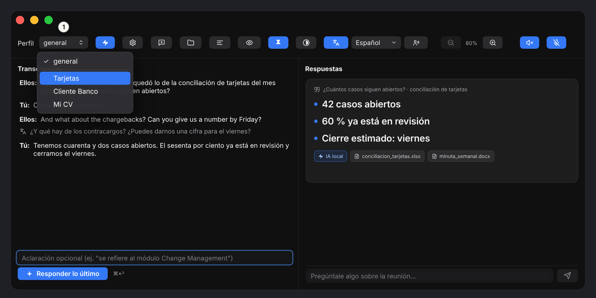
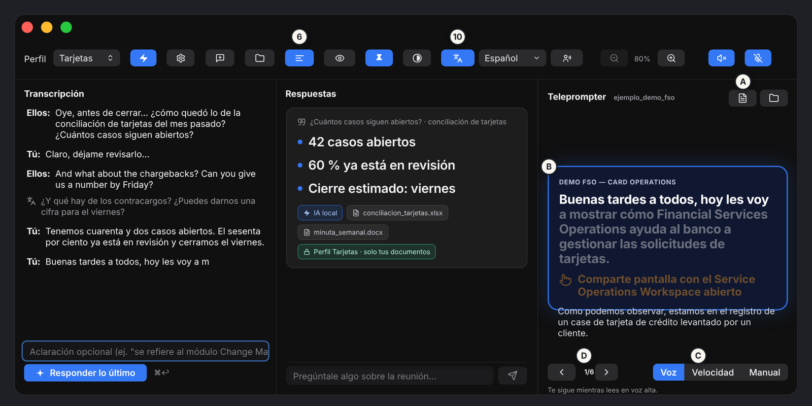

<div class="cover">

# NextHelp

## User Manual

Your copilot for any meeting · Version 1.0 · macOS (Apple silicon)

*by Zeedatik · [zeedatik.com](https://zeedatik.com)*

</div>

<div class="pagebreak"></div>

# 1. What NextHelp is

NextHelp is a Mac app that keeps you company during a meeting, a class or a call. **It listens, transcribes, translates and suggests what to say**, using information from your own documents.

At a glance:

1. **It listens** to two sources: what plays on your Mac (the other people on the call, which the app calls **"Them"**) and your microphone (**"You"**).
2. **It transcribes** live, on your Mac and without internet.
3. When someone asks you a question, you press **Answer the latest** and the AI proposes an answer, based on the documents in the **profile** you chose.

> By default, transcription and AI run on your Mac. If you choose a cloud AI provider, the text you send is processed by that provider.

> Button names in this manual are the ones shown when the app language is English (**Settings → General → App language**). In Spanish, "Them" is "Them" and "You" is "You".

# 2. Requirements and installation

- A Mac with **Apple silicon (M1 or later)**. There is no Intel version.
- **macOS 15 or later** (macOS 26 recommended: better transcription and translation).
- 5–10 GB of free disk if you want local AI models.

**Install in four steps** (full guide in [INSTALL.md](INSTALL.md)):

1. Download the `.dmg` from the [Releases page](https://github.com/zeedatik/NextHelp/releases/latest).
2. Open it and drag **NextHelp** into **Applications**.
3. Open **Terminal** and run this once:

   ```bash
   xattr -dr com.apple.quarantine /Applications/NextHelp.app
   ```

   This is needed because the app is not yet notarized by Apple. Without it, macOS only offers "Move to Trash" or "Done" and the app will not open. Do not move it to the Trash.
4. Open NextHelp from Applications.

# 3. First launch

**Terms and privacy.** The first time, you must read and accept the Terms of Use and the Privacy Notice. By accepting, you take responsibility for informing the people you transcribe and obtaining their consent.

**macOS permissions.** The app will ask for:

| Permission | What it is for |
|---|---|
| Microphone | Transcribing what you say. |
| Speech Recognition | Turning audio into text. |
| Screen & System Audio Recording | Hearing the other people on the call ("Them"). |

If you miss one, enable it in **System Settings → Privacy & Security** and reopen the app.

**Welcome assistant.** It checks your Mac (memory and free disk), recommends models and, if you accept, **installs Ollama** (the program that runs local models) and **downloads the recommended models**. You do not need the terminal. It can take several minutes depending on your connection: wait for it to finish before your first meeting. If you prefer a cloud service, choose **"I prefer to use a cloud provider"** and add your provider (see section 11).

When done you will see **"All set"**. You can repeat the assistant later from **Settings → Services → Repeat welcome**.

# 4. A tour of the window



The window has three areas: **A) Transcript** (what is said), **B) Answers** (what the AI suggests) and **C) the optional clarification field with the "Answer the latest" button**. The button bar is on top. A **blue** button means that feature is on.

| No. | Button | What it does |
|---|---|---|
| 1 | **Profile** | Chooses the group of documents used to answer (section 7). |
| 2 | **Fast / Reason** | Fast answers in a few seconds. Reason makes the model think before answering: more accurate, but it can take minutes. |
| 3 | **Settings** | Models, context window, voice, providers, services and profiles. |
| 4 | **New meeting** | Saves the current transcript and starts a new `.txt` file. |
| 5 | **Transcripts** | Opens the folder where each meeting's `.txt` is saved. |
| 6 | **Teleprompter** | Shows or hides the teleprompter (section 8). Use the same button to remove it. |
| 7 | **Visible / Hidden when sharing** | When set to "Hidden", this window does not appear when you share your screen (section 9). |
| 8 | **Always on top** | The window floats above other apps, also in full screen and on all desktops. |
| 9 | **Appearance** | Background and text transparency, text color and compact mode. |
| 10 | **Translate** | Translates live and puts the translation under each line (section 6). |
| 11 | **Language** | List of languages to translate to ("Translate to"). |
| 12 | **My phrases** | Also translates what you say. By default only what "Them" say is translated. |
| 13 | **− 80 % +** | Shrinks or enlarges the whole app: text, buttons and window (⌘− and ⌘+). |
| 14 | **Mute internal audio** | Stops transcribing what plays on the Mac ("Them"). |
| 15 | **Mute my mic** | Stops transcribing what you say. |

Buttons may show only their icon (compact mode). Hover over one to see its description.

# 5. Transcript and answers

## The transcript

- **"Them"** lines come from your Mac's audio. **"You"** lines come from your microphone.
- A line in *italics* is not confirmed yet: wait until it stops being italic before correcting it.
- To **correct** a line, click its pencil, edit the text and confirm with **Enter** (or **Esc** to cancel). It is marked "Edited by hand".
- Click one or more lines to **select** them. **Delete** removes them from the transcript and **Clear** clears the selection.
- Each meeting is saved automatically at `~/Documents/MeetingAssistant/Transcripciones/reunion-YYYY-MM-DD_HH-mm.txt`. The file also reflects your corrections and deletions. **New meeting** closes the current file and starts another.

## Asking for an answer

| I want to... | Do this |
|---|---|
| Answer the latest thing "Them" said | Press **Answer the latest** or use **⌘↩**. |
| Answer a specific part | Select one or more lines and press **Answer selection**. |
| Give the AI context | Type an **optional clarification** (for example "it refers to the Change Management module"). It helps search your documents better. |
| Ask a free question | Type at the bottom in "Ask something about the meeting…". The AI reads the whole transcript and the profile's documents. |
| Go deeper on an answer | Press **Expand**: adds a more developed version to the same thread. |
| Ask about one specific thread | Press **Selected / Ask** on that thread; what you type below is asked about it. |
| Stop an answer | Press **Stop**. |

Each answer shows which **sources** (documents) it came from. In **Reason** mode you can open **Show reasoning**.

# 6. Translation

Translation **runs on your Mac with the macOS translator, without internet**.

1. Press the **Translate** button (10). It turns blue and the translation appears under each line.
2. To choose the language, open the language list next to the button (11). If a language is missing its pack (⬇︎), macOS asks permission to download it **just once**. A ✓ means it is ready, and "(vía modelo)" means it will be translated with the AI model.
3. To turn it off, press **Translate** again.

**Important: by default only what "Them" say is translated.** If you also want to see the translation of what you say, press the **My phrases** button (12), next to the language list. It turns blue when on; press it again to turn it off.

If you see "Could not translate", check **System Settings → General → Language & Region → Translation Languages**.

# 7. Profiles and documents

## What a profile is

A **profile** is a group of documents about a topic: for example your CV and projects, the material of a course, or a client's manuals. You switch profiles with the **Profile** selector (1) and the AI answers using that material.

| Profile | How it answers |
|---|---|
| **general** | Documents only **support**. If there are none or they do not help, the AI still answers from its own knowledge and the transcript. |
| **Any profile you create** | Strict mode: the AI answers **only from what your documents** in that profile say. If the profile has no documents, the app tells you. |



## Creating a profile and adding documents

1. Open **Settings → Profiles**.
2. Press **New profile** and type a name. Only lowercase letters without accents, numbers and underscore (`_`) are allowed; anything else becomes `_`. Examples: `my_cv`, `backend_interview`, `physics_2`.
3. Select the profile and press **Add documents…**. You can pick several at once.
4. Wait for indexing to finish (the app shows progress). You will see how many fragments each document has.
5. Close Settings, choose the profile in the selector and start asking.

## Supported documents

| Format | Notes |
|---|---|
| **`.md` (Markdown)** | **The best format.** Clean text with titles and sections. |
| **`.txt`** | Plain text. |
| **`.pdf`** | Must have **selectable text**. A scanned PDF (images only) cannot be read. |
| `.csv`, `.json` | Read as text. |

Word (`.docx`), Excel (`.xlsx`) and PowerPoint (`.pptx`) are **not supported yet**. If your information is there, export it to PDF or copy it into a `.md`.

## Writing good documents

The app splits each document into fragments by **paragraphs** (separated by a blank line) of about 1,200 characters, and for each question it looks for the most similar fragments. So it helps to:

- Use **one topic per section**, with a clear title (`## Thesis project`).
- Use **short paragraphs separated by a blank line.**
- Include **names, figures and terms the way you would say them** in a meeting.
- Keep one file per large topic (a CV, a course, a client) instead of one giant file.

Example of a `.md` for interviews:

```markdown
# Jane Doe — CV

## Project: Study room booking
Web app to book study rooms.
Technologies: Python, FastAPI and PostgreSQL. I cut booking time
from 5 minutes to 30 seconds.

## Project: Inventory dashboard
Dashboard for a small store. Built with React and a REST API.
My role: design and development. Result: used daily by 4 employees.
```

## Maintaining profiles

- **Reindex:** if you change the embeddings model (Settings → Models), profiles are marked as outdated. Press **Reindex** to search them again.
- **Show documents folder in Finder:** the app keeps a copy of each document in `~/Library/Application Support/NextHelp/Perfiles/<profile>/`. Your original files are **not touched**.
- **Delete profile:** removes its index and copies; your original files stay intact.
- If you use a cloud provider with a profile, the parts of your documents that are needed **leave your Mac** and go to that service.

# 8. Teleprompter

The teleprompter helps you present a demo or talk without losing your place.



1. Press **Teleprompter** (button 6) to show it. **To remove it, press the same button again.**
2. In the teleprompter column, press the document button (**A**) to **open a script** `.md` or `.txt`, or the folder button to open the scripts folder (`~/Documents/MeetingAssistant/Guiones/`).
3. The card (**B**) shows the **current step** and, below it, the next one. The counter (**D**) shows "Step 1 of 6" and the arrows change step.
4. Choose the **mode** (**C**):

| Mode | How it advances |
|---|---|
| **Voice** | Follows you as you read aloud: it advances when you say the **start** and the **end** of the step. |
| **Speed** | Scrolls by itself at the words per minute you choose. |
| **Manual** | You move it with the arrows or by tapping a step. |

## Script format

A text or Markdown file with these rules:

- A **normal line** is what you **say**. It is used to detect your progress in Voice mode.
- A line between **double asterisks** (`**like this**`) is what you **do on screen** (an action).
- A **blank line** separates one step from the next.
- A line starting with `#` is a section **title** (optional).

```markdown
# Product demo

Good afternoon everyone, today I will show how the reports module works.
**Share your screen with the dashboard open**

Here we see the monthly sales summary, by region.
**Point at the bar chart**
```

# 9. Screen sharing and window

- **Visible / Hidden when sharing (7).** When set to "Hidden", the NextHelp window does not appear in what others see when you share your screen, but you still see it. **Always test it with a practice call before an important meeting**, because each video-call app captures the screen in its own way.
- **Always on top (8).** Keeps the window visible above other apps.
- **Appearance (9).** Adjusts background and text transparency, text color (Auto, White or Black) and **compact mode**, which leaves only icons for a much shorter, narrower window.
- **Zoom (13).** Makes the whole app bigger or smaller (⌘+ and ⌘−).

# 10. Voice and languages

It is in **Settings → Voice**. Everything is recognized on your Mac, without internet.

- **Voice language:** *Spanish + English* (recommended: it uses two recognizers and picks, word by word, the more confident one; good for Spanish sentences with English terms), *Spanish only* or *English only*.
- **Language switching:** *Conservative* (favors the language that dominates the sentence), *Normal* or *Sensitive* (detects any word in another language).
- **Custom vocabulary:** names, acronyms and terms that come out wrong; one per line or comma-separated. Applying it restarts the transcription for a few seconds.
- **App language:** in **Settings → General**. It does not change the language you are transcribed in or the one you translate to.

If macOS does not have offline dictation for the language, turn it on in **System Settings → Keyboard → Dictation**.

# 11. Models, context and providers

All of this is changed in **Settings**, and the initial setup (**Balanced**) works well on almost any Mac.

## Models

Choose which model each function uses: fast answers, reasoning and **embeddings** (document search; required to use profiles with documents). You can **install models** from the Ollama library; the app marks the ones recommended for your Mac. Changing the embeddings model requires reindexing profiles.

## Context

How much the AI can read at once (transcript, documents and question). More context reads more of the meeting but uses more memory:

| Option | Reads about | Recommendation |
|---|---|---|
| Light | 4 min of meeting | Very fast, low memory. |
| **Balanced** (default) | 8 min | Balance for almost any Mac. |
| Wide | 16 min | Uses more memory. |
| Very wide | 30 min | From 16 GB of RAM. |
| Maximum | 1 hour | Only with 32 GB of RAM or more. |

If the meeting does not fit, the oldest part is trimmed and the app tells you next to the answer.

## Providers

A provider is the service that runs the models. **Ollama** (local) is the default and nothing leaves your Mac. You can also add an **OpenAI-compatible** one (OpenAI, OpenRouter, Groq, LM Studio and others) or **Anthropic**, with your own API key. The key is stored in the macOS **Keychain**.

With a cloud provider, what you ask and the needed parts of the transcript and your documents **leave your Mac** and go to that service.

## Services

Shows Ollama's status (address, port, version), lets you restart it and see its log, save memory with the compressed KV cache, and **Copy diagnostics** to ask for support.

# 12. Keyboard shortcuts

| Shortcut | Action |
|---|---|
| **⌘↩** | Answer the last thing. |
| **⌘ +** / **⌘ −** | Enlarge / shrink the whole app. |
| **Enter** / **Esc** | Save / cancel a line correction. |

# 13. Use cases

- **Interview (for practice).** Create the profile `my_cv` with your CV and projects in `.md`. Simulate the interview with a friend, and when they ask about a project, press **Answer the latest**: it proposes an answer based on your own CV. Use it only where it is allowed.
- **Meeting in another language.** Turn on **Translate**, choose the language and read the translation under each line.
- **Online class.** Create one profile per course with your notes in `.md` and ask to review what the teacher just said.
- **You lost the thread.** Use the free question ("what has been agreed so far?") to get a summary of what was last discussed.
- **Presentation or demo.** Write your script, open it in the teleprompter in **Voice** mode and leave the button on **Hidden when sharing**.

# 14. Troubleshooting

| Problem | What to do |
|---|---|
| macOS only offers "Move to Trash" or "Done" and the app will not open. | Run `xattr -dr com.apple.quarantine /Applications/NextHelp.app` in Terminal and open it again. Needed only once. |
| It says the app "is damaged". | Repeat the command above and make sure NextHelp is in Applications, not inside the DMG. |
| It does not transcribe what others say. | Check the **Screen & System Audio Recording** permission and that **Mute internal audio** (14) is not on. |
| macOS does not recognize the system audio permission. | Quit the app (⌘Q), remove it from Privacy & Security → Screen & System Audio Recording with the **−** button, run `tccutil reset ScreenCapture com.luisrangel.meetingassistant`, restart your Mac and grant the permission again. |
| It does not transcribe what I say. | Check the **Microphone** permission and that **Mute my mic** (15) is not on. |
| It does not translate. | Check System Settings → General → Language & Region → Translation Languages, and download the language from the language list (11). |
| Only what others say is translated. | That is normal. Turn on the **My phrases** button. |
| "The profile … has no indexed documents yet". | Add documents in Settings → Profiles, or switch to the **general** profile. |
| A profile's documents do not answer well. | Reindex the profile, and use files with real text and clear sections (`.md`). |
| Answers take too long. | Use **Fast** mode, lower the context window or choose a smaller model. |
| Ollama does not respond. | Settings → Services → **Restart** and check the log. |
| A PDF is not indexed. | It is probably a scan without text. Convert it with OCR or copy it into a `.md`. |
| After updating, macOS asks for permissions again. | Normal with each new version. Grant them again. |

# 15. Where your things are stored

| What | Where |
|---|---|
| Transcripts | `~/Documents/MeetingAssistant/Transcripciones/` |
| Teleprompter scripts | `~/Documents/MeetingAssistant/Guiones/` |
| Profiles and document copies | `~/Library/Application Support/NextHelp/Perfiles/` |
| Ollama models | `~/.ollama` |

**Uninstall:** drag NextHelp to the Trash. To also remove its data, delete the folders in the table.

# 16. Privacy and responsible use

- By default, transcription and AI run on your Mac. Zeedatik does not receive your conversations or documents.
- If you connect a cloud AI provider, the text you send is processed by that provider under its own terms.
- **Inform people and get their consent** before transcribing them, according to the law and your school's or company's rules.
- Respect the rules of the interview, exam or meeting where you use it.

The full texts are in [`legal/`](legal/) and in the **Privacy Notice** shown when you open the app.

# 17. Support

Something not working, or have an idea? Open an [Issue](https://github.com/zeedatik/NextHelp/issues) and include your macOS and NextHelp versions (Settings → Services). For a diagnostic, use **Settings → Services → Copy diagnostics**.

---

© 2026 [Zeedatik](https://zeedatik.com). All rights reserved.
