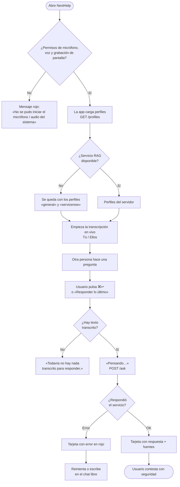
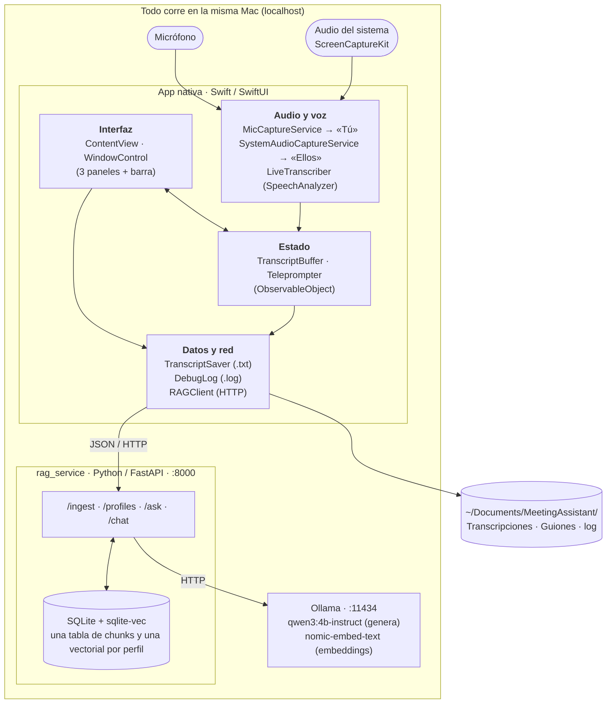
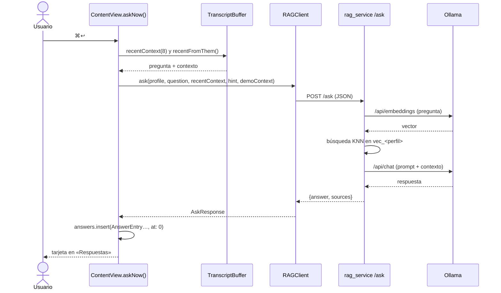

# NextHelp — copiloto local para reuniones, demos y entrevistas

> **Entrega 1 del proyecto** · Desarrollo de aplicaciones móviles nativas · ESCOM-IPN · Ingeniería en Sistemas Computacionales (plan 2020)
> **Ruta elegida:** idea propia, desarrollada desde cero.
> **Repositorio:** https://github.com/LuisRan/NextHelp

NextHelp escucha una reunión en vivo (tu micrófono y el audio del sistema), la transcribe **sin salir de tu equipo**, y con un atajo de teclado te sugiere una respuesta breve a lo último que te preguntaron, apoyándose en tus propios documentos. Además incluye un teleprompter que avanza solo según lo que vas diciendo y una ventana que no aparece cuando compartes pantalla.

> ⚠️ **Plataforma.** La aplicación es una app **nativa de macOS 26+** hecha con SwiftUI (usa `ScreenCaptureKit`, `AppKit` y `SpeechAnalyzer`, que no existen en iOS). El proyecto de Xcode se creó con la plantilla multiplataforma, por eso `project.pbxproj` conserva claves de iOS, pero **ningún archivo fuente compila para iOS**. Todo lo que se documenta aquí corresponde a la versión de macOS.

> 🧾 **Estado de este documento.** Todo lo descrito en las Partes 1 y 2 sale del código real del repositorio (se citan archivos, líneas y fragmentos). Lo que requiere evidencia que solo el equipo puede generar —capturas, ligas de issue/PR/CI, resultados reales de pruebas, nombres de integrantes— está marcado con **☐ Pendiente** y **no** se rellenó con datos inventados.

## Contenido

- [Equipo](#equipo)
- [Parte 1 — Idea original](#parte-1--idea-original-de-la-aplicación)
- [Parte 2 — Arquitectura, código y repositorio](#parte-2--el-proyecto-arquitectura-código-y-repositorio)
- [Parte 3 — Pull Request del curso](#parte-3--pull-request-completo-con-el-procedimiento-del-curso)
- [Uso responsable](#uso-responsable)
- [Declaración de uso de IA](#declaración-de-uso-de-ia)
- [Lista de verificación de la entrega](#lista-de-verificación-de-la-entrega)

## Equipo

| Integrante | Usuario de GitHub | Aportación principal |
|---|---|---|
| Luis Rangel | [@LuisRan](https://github.com/LuisRan) | Captura de audio, transcripción, servicio RAG |
| ☐ Pendiente | ☐ | ☐ |
| ☐ Pendiente | ☐ | ☐ |

---

# Parte 1 — Idea original de la aplicación

## 1.1 Ficha de idea (`docs/idea.md`)

| Campo | Contenido |
|---|---|
| **Ruta elegida y motivo** | Idea propia desde cero. Ninguna de las seis rutas del curso cubre captura de audio del sistema, reconocimiento de voz local y modelos de lenguaje locales; el equipo quiere aprender esas APIs nativas de Apple. |
| **Usuario y contexto** | Profesional de TI, consultor o estudiante que participa en **videollamadas** (demos para clientes, entrevistas técnicas, juntas de seguimiento), en su propia Mac, mientras comparte pantalla o atiende a otra persona y **no puede buscar una respuesta sin que se note**. |
| **Problema (una frase)** | Cuando alguien te hace una pregunta en una videollamada, recordar el dato exacto o encontrarlo en tus documentos toma más tiempo del que la conversación permite. |
| **Alternativa actual** | Notas en otra ventana o en papel; buscar manualmente en documentos; preguntar a un chat de IA en el navegador (lento, obliga a copiar la pregunta, y **envía el contenido de la reunión a un servicio en la nube**). |
| **Tarea principal** | Con un solo atajo (`⌘↩`), obtener una respuesta de 2–4 líneas a lo último que dijo la otra persona, basada en los documentos del perfil activo. |
| **Criterio de éxito** | Ver la respuesta con sus fuentes en el panel *Respuestas* sin salir de la llamada, **sin que ningún dato salga de la Mac** (ver criterio de aceptación en 1.3). |
| **Alcance de la primera versión** | Transcripción en vivo de dos fuentes («Tú» y «Ellos»); corrección y borrado manual de líneas; responder a lo último o a líneas seleccionadas, con aclaración opcional; chat libre sobre la reunión; perfiles de documentos (RAG local); teleprompter con avance por voz; guardado automático en `.txt`; ventana invisible al compartir pantalla, siempre encima y con transparencia. |
| **Funciones aplazadas (a propósito)** | Versión para iOS/iPadOS; separar a más de una persona en «Ellos»; resumen automático al terminar la reunión; subir documentos desde la interfaz (hoy es con script); idiomas distintos de es-MX; sincronización entre equipos; responder sin intervención del usuario. |
| **Hipótesis pendiente de validar** | «Un modelo de 4 B parámetros cuantizado, corriendo en una Mac M1 de 8 GB, responde con calidad útil en pocos segundos». **No está medida todavía** (☐ Pendiente: registrar tiempos reales en `docs/pruebas.md`). |

**Evidencia que sostiene la idea (honesta).** Aún no hay validación con usuarios externos: la idea es una **hipótesis sin validar con terceros**. Lo que sí existe son pruebas de uso propias del autor con la app funcionando: cuatro transcripciones guardadas (28-sep-2026 y 30-sep-2026) y un registro de diagnóstico con 67 frases finales reconocidas. ☐ Pendiente: entrevistar al menos a dos usuarios objetivo y registrar fecha, método y resultado.

## 1.2 Material visual

### Bosquejo de la pantalla principal

La ventana tiene una barra superior y hasta tres paneles (`HSplitView`). Los estados que no son ruta feliz están anotados con `[E1]`…`[E5]`.

```text
┌──────────────────────────────────────────────────────────────────────────────────────────┐
│ [Perfil ▾ servicenow] [＋Nueva reunión] [📁Transcripciones] [Teleprompter] [👁 Invisible]│
│ [📌 Encima de todo] [◐───]                      [🔈 Silenciar audio interno] [🎤 Mutear] │
├───────────────────────────┬────────────────────────────┬─────────────────────────────────┤
│ TRANSCRIPCIÓN             │ RESPUESTAS            [⟳] │ TELEPROMPTER      guion.md  📄 📁│
│                           │                            │                                 │
│ Ellos: ¿Cómo cierran un   │ ┌────────────────────────┐ │   (paso anterior, atenuado)     │
│  incidente P1?            │ │ ✨ servicenow  18:20   │ │ ┌─────────────────────────────┐ │
│ Tú: Buena pregunta, …  ✏️ │ │ "¿Cómo cierran un…"    │ │ │ PASO ACTUAL, letra grande   │ │
│ Ellos: …(en cursiva =     │ │ Requiere aprobación    │ │ │ 👆 Acción a hacer en pantalla│ │
│        aún sin confirmar) │ │ del lead de guardia.   │ │ └─────────────────────────────┘ │
│                           │ │ Fuentes: manual.txt    │ │   (paso siguiente)              │
│ Clic en líneas para       │ └────────────────────────┘ │                                 │
│ seleccionarlas            │                            │ [‹] Paso 2 de 6 [›] ▓▓▓░░ [⏽]  │
│ [Aclaración opcional    ] │ [Pregúntale algo sobre la  │       Avance por voz            │
│ [✨ Responder lo último ⌘↩]│  reunión…            ][➤] │                                 │
│ [E4] texto rojo de error  │ [E1] «Pensando…» + spinner │ [E2] «Abre un guion para        │
│                           │ [E3] «Aquí aparecerán las  │       empezar.»                 │
│                           │      respuestas.»          │                                 │
└───────────────────────────┴────────────────────────────┴─────────────────────────────────┘
```

| Marca | Estado | Qué ve el usuario | Dónde está en el código |
|---|---|---|---|
| **[E1]** | Carga | El botón cambia a «Pensando…» y se deshabilita; spinner en *Respuestas* | `ContentView.swift` · `isAsking`, `answerPanel` |
| **[E2]** | Lista vacía (teleprompter) | «Abre un guion para empezar.» | `teleprompterPanel` |
| **[E3]** | Lista vacía (respuestas) | «Aquí aparecerán las respuestas.» | `answerPanel` |
| **[E4]** | Dato inválido | «Todavía no hay nada transcrito para responder.» (texto rojo) | `askNow()` |
| **[E5]** | Error de servicio | Tarjeta de respuesta con el mensaje en rojo (p. ej. «No me pude conectar a Ollama en localhost:11434…») | `askNow()` · `catch`, `RAGClient.post` |

> *Pie de figura:* boceto en texto de la interfaz, elaborado con **Claude (IA)** a partir de `ContentView.swift` y revisado por el equipo. ☐ Pendiente: sustituir o complementar con un boceto a mano/Figma en `docs/img/` (el curso pide al menos uno).

### Recorrido del usuario



> *Pie de figura:* diagrama de flujo del recorrido de la tarea principal, elaborado con **Claude (IA)** en Mermaid a partir del comportamiento de `ContentView.swift` y `RAGClient.swift`.

## 1.3 Historia de usuario y criterio de aceptación

**Historia.** Como *profesional que da demos y entrevistas por videollamada*, quiero *obtener con un atajo una respuesta breve a la última pregunta que me hicieron, basada en mis documentos*, para *contestar con seguridad sin salir de la llamada y sin enviar la conversación a la nube*.

**Criterio de aceptación (verificable, sí/no).**

> **Dado** que la app está abierta con los permisos concedidos, el servicio RAG y Ollama están corriendo, el perfil activo es `servicenow` con documentos indexados, y en la transcripción hay al menos una línea de «Ellos»,
> **cuando** pulso `⌘↩`,
> **entonces** en menos de 120 s aparece como primera tarjeta del panel *Respuestas* una tarjeta con (a) la pregunta citada, (b) un texto de respuesta y (c) la línea «Fuentes: …» con al menos un archivo, y el botón vuelve a decir «Responder lo último».

**Criterio del estado alterno.**

> **Dado** que la transcripción está vacía, **cuando** pulso `⌘↩`, **entonces** aparece en rojo «Todavía no hay nada transcrito para responder.» y **no** se agrega ninguna tarjeta.

> El límite de 120 s no es arbitrario: es el `timeoutInterval` de la petición en `RAGClient.swift` (el backend espera hasta 90 s a Ollama en una carga en frío).

## 1.4 Evidencias de la Parte 1

- [x] Ficha de idea (esta sección; copiar a `docs/idea.md` si el docente exige el archivo separado).
- [x] Bosquejo, diagrama del recorrido y estados no felices.
- [x] Historia de usuario con criterio de aceptación.
- [ ] ☐ Pendiente: exposición en clase (máx. 5 min).

---

# Parte 2 — El proyecto: arquitectura, código y repositorio

## 2.1 Estructura del repositorio

Hoy el código vive en dos carpetas locales (`MeetingAssistant/` para la app y `meeting-assistant/` para el servicio RAG). **El repositorio NextHelp las unifica** con esta estructura:

```text
NextHelp/
├── README.md                          ← este documento
├── .gitignore
├── MeetingAssistant.xcodeproj/        ← proyecto de Xcode (configuración de construcción)
│   └── project.pbxproj
├── MeetingAssistant/                  ← código fuente de la app (Swift, 12 archivos, 1 775 líneas)
│   ├── MyApp.swift                    ← punto de entrada (@main)
│   ├── ContentView.swift              ← interfaz + orquestación (668 líneas)
│   ├── TranscriptSegment.swift        ← modelo: una frase, quién la dijo y cuándo
│   ├── TranscriptBuffer.swift         ← estado: transcripción compartida por las dos fuentes
│   ├── MicCaptureService.swift        ← captura del micrófono («Tú»)
│   ├── SystemAudioCaptureService.swift← captura del audio del sistema («Ellos»)
│   ├── LiveTranscriber.swift          ← reconocimiento de voz local (SpeechAnalyzer)
│   ├── RAGClient.swift                ← cliente HTTP hacia el servicio local
│   ├── Teleprompter.swift             ← parser de guiones + avance por voz
│   ├── TranscriptSaver.swift          ← guardado automático en .txt
│   ├── WindowSharing.swift            ← invisibilidad, «encima de todo», transparencia
│   ├── DebugLog.swift                 ← registro de diagnóstico a archivo
│   ├── Assets.xcassets/               ← recursos (solo AccentColor)
│   └── Info.plist                     ← vacío; los permisos están en build settings
├── rag_service/                       ← servicio local (Python, FastAPI)
│   ├── main.py                        ← endpoints /ingest /profiles /ask /chat (411 líneas)
│   └── requirements.txt               ← dependencias fijadas
├── docs/
│   └── servicenow/                    ← documentos de ejemplo para el perfil «servicenow»
├── Guiones/
│   └── ejemplo_demo_fso.md            ← guion de ejemplo para el teleprompter
├── setup.sh                           ← instala Ollama, modelo de embeddings y venv
├── ingest_docs.sh                     ← indexa docs/<perfil>/* en el RAG
└── .github/workflows/                 ← ☐ Pendiente: CI (ver más abajo)
```

| Elemento | Dónde / qué es |
|---|---|
| **Punto de entrada** | `MeetingAssistant/MyApp.swift` → `@main struct MyApp: App` abre un `WindowGroup { ContentView() }`. Del servicio: `rag_service.main:app` (se lanza con `uvicorn`). |
| **Configuración de construcción** | `MeetingAssistant.xcodeproj/project.pbxproj`. Valores relevantes: `MACOSX_DEPLOYMENT_TARGET = 26.0`, `PRODUCT_BUNDLE_IDENTIFIER = com.luisrangel.meetingassistant`, `ENABLE_APP_SANDBOX = NO`, `SWIFT_VERSION = 5.0`, `SWIFT_DEFAULT_ACTOR_ISOLATION = MainActor`, y los textos de permiso `NSMicrophoneUsageDescription` y `NSSpeechRecognitionUsageDescription`. Dependencias Python: `rag_service/requirements.txt`. |
| **Recursos** | `Assets.xcassets` (solo color de acento). No hay imágenes ni fuentes de terceros. |
| **Documentación** | Este README y `docs/`. |

### `.gitignore`: qué se excluye y por qué

| Patrón | Motivo |
|---|---|
| `rag_service/venv/` | Entorno virtual de Python (cientos de archivos, dependiente de la máquina; se recrea con `setup.sh`). |
| `rag_service/__pycache__/`, `*.pyc` | Bytecode generado. |
| `rag_service/data/` | Base SQLite con los vectores (`meeting_assistant.db`): se regenera con `ingest_docs.sh` y puede contener contenido privado. |
| `rag_service/main.py.bak*` | Copias de respaldo manuales; para eso está Git. |
| `Transcripciones/` | **Transcripciones reales de reuniones**: contienen conversaciones de terceros y datos personales. Nunca deben versionarse. |
| `*-debug.log` | Registro de diagnóstico (`MeetingAssistant-debug.log`); contiene texto reconocido. |
| `xcuserdata/`, `*.xcuserstate` | Estado personal de Xcode (ventanas abiertas, esquemas por usuario). |
| `.DS_Store` | Basura de Finder. |
| `Guiones/*` salvo `ejemplo_demo_fso.md` | Los guiones propios de cada usuario pueden contener información de clientes; solo se versiona el de ejemplo. |

> **Atención.** En la máquina del autor el proyecto vive en `~/Documents/MeetingAssistant/`, que es exactamente la ruta donde la app guarda `Transcripciones/`, `Guiones/` y el `.log`. Por eso esos tres elementos aparecen mezclados con el código y **deben quedar en `.gitignore` antes del primer commit**.

### Integración continua (`.github/workflows`)

El repositorio **todavía no tiene flujos de CI**. Propuesta (☐ Pendiente: añadir y dejar ejecutándose antes de entregar):

| Flujo | Comprueba | Nota |
|---|---|---|
| `python-ci.yml` (ubuntu) | Instala `rag_service/requirements.txt`, compila `main.py` (`python -m py_compile`) y corre pruebas unitarias de funciones puras: `chunk_text` y `safe_profile_name`. | Se puede verificar 100 % de forma automática. |
| `swift-build.yml` (macOS) | `xcodebuild -project MeetingAssistant.xcodeproj -scheme MeetingAssistant build CODE_SIGNING_ALLOWED=NO`. | Requiere un runner con el SDK de **macOS 26**; si no está disponible, queda como QA manual y se documenta. |

```yaml
# .github/workflows/python-ci.yml  (propuesta)
name: python-ci
on: [push, pull_request]
jobs:
  rag-service:
    runs-on: ubuntu-latest
    steps:
      - uses: actions/checkout@v4
      - uses: actions/setup-python@v5
        with: { python-version: "3.12" }
      - run: pip install -r rag_service/requirements.txt pytest
      - run: python -m py_compile rag_service/main.py
      - run: pytest -q
```

### Licencia y procedencia de recursos (`docs/licencias.md`)

| Recurso | Uso | Licencia (☐ verificar antes de entregar) |
|---|---|---|
| Código de NextHelp | — | ☐ Pendiente: elegir y agregar `LICENSE` (p. ej. MIT). |
| Ollama | Ejecuta los modelos localmente | MIT |
| Qwen3 `qwen3:4b-instruct-2507-q4_K_M` | Generación de respuestas | Apache 2.0 |
| `nomic-embed-text` | Embeddings para el RAG | Apache 2.0 |
| FastAPI · Uvicorn · Starlette | Servidor HTTP | MIT · BSD-3 · BSD-3 |
| `sqlite-vec` | Búsqueda vectorial dentro de SQLite | MIT / Apache 2.0 |
| `requests` · `python-multipart` · `pypdf` | HTTP hacia Ollama · formularios · lectura de PDF | Apache 2.0 · Apache 2.0 · BSD-3 |
| Frameworks de Apple (SwiftUI, AppKit, AVFoundation, Speech, ScreenCaptureKit, CoreAudio) | Interfaz, audio y voz | Términos del SDK de Apple |
| `docs/servicenow/fso_financial_services_operations.txt` | Documento de ejemplo del RAG (17 KB) | ☐ Pendiente: confirmar procedencia (resumen propio de documentación pública de ServiceNow) |

## 2.2 Arquitectura de la aplicación



> *Pie de figura:* arquitectura general elaborada con **Claude (IA)** en Mermaid a partir del código fuente.

### Dónde vive cada cosa

| Responsabilidad | Ubicación | Detalle |
|---|---|---|
| **Interfaz** | `ContentView.swift`, `WindowSharing.swift` | `toolbar`, `transcriptPanel`, `answerPanel`, `teleprompterPanel`; `WindowControl` ajusta `NSWindow` (`sharingType`, `level`, `alphaValue`). |
| **Lógica de presentación** | `ContentView.swift` (`askNow`, `sendChat`, `newMeeting`, `startCapture`) | Orquesta captura, preguntas y errores. |
| **Estado / modelo** | `TranscriptSegment.swift`, `TranscriptBuffer.swift`, `Teleprompter.swift` | Buffer cronológico único; el teleprompter observa el buffer y avanza. |
| **Captura y reconocimiento** | `MicCaptureService`, `SystemAudioCaptureService`, `LiveTranscriber` | Dos instancias independientes de `SpeechAnalyzer`, una por fuente. |
| **Acceso a datos** | Local: `TranscriptSaver` (archivos `.txt`). Servicio: `rag_service/main.py` (SQLite + `sqlite-vec`). | No hay base de datos dentro de la app. |
| **Comunicación** | `RAGClient.swift` ↔ `rag_service/main.py` ↔ Ollama | JSON sobre HTTP, solo `localhost`. |

### Dependencias externas

| Dependencia | Para qué se usa |
|---|---|
| **SwiftUI / Combine** | Interfaz declarativa y publicación de cambios de estado. |
| **AppKit** | `NSWindow` (invisibilidad, flotante), `NSOpenPanel`, `NSWorkspace`. |
| **AVFoundation / CoreAudio** | `AVAudioEngine` para el micrófono; conversión de formato; escucha de cambios de dispositivo. |
| **Speech** (`SpeechAnalyzer`, `SpeechTranscriber`) | Reconocimiento de voz **en el dispositivo**, español (es-MX). |
| **ScreenCaptureKit** | Captura del audio que reproduce el sistema (la otra persona en la llamada). |
| **FastAPI + Uvicorn** | API HTTP del servicio RAG. |
| **sqlite-vec** | Índice vectorial dentro del mismo archivo SQLite. |
| **requests** | Llamadas del servicio a Ollama. |
| **pypdf** | Extraer texto de PDF al indexar. |
| **python-multipart** | Recibir archivos en `/ingest`. |
| **Ollama** + modelos | Ejecutar el LLM y el modelo de embeddings localmente (Metal). |

### Qué corre en el dispositivo y qué depende de un servicio externo

- **Todo se ejecuta en la Mac del usuario**: app, servicio RAG y Ollama (`localhost`). En uso normal **no sale ningún dato a internet**.
- Se necesita internet **una sola vez** para: descargar el modelo de voz de es-MX (lo hace `AssetInventory` al primer arranque) y los modelos de Ollama.
- No hay cuentas, claves de API ni servidores propios.

## 2.3 Recorrido del código: «Responder lo último»

Funcionalidad elegida: la tarea principal de la Parte 1, de la pulsación a la tarjeta en pantalla.



**1. La acción del usuario** — `MeetingAssistant/ContentView.swift` (~l. 210–222):

```swift
Button {
    Task { await askNow() }
} label: {
    Label(isAsking ? "Pensando…" : (selectedIDs.isEmpty ? "Responder lo último" : "Responder selección"),
          systemImage: "sparkles")
}
.buttonStyle(.borderedProminent)
.disabled(isAsking)
// ⌘↩ (⌘Espacio lo usa Spotlight y nunca llegaba a la app).
.keyboardShortcut(.return, modifiers: [.command])
```

**2. Armar la pregunta y manejar el estado vacío** — `ContentView.swift`, `askNow()` (l. 581):

```swift
private func askNow() async {
    // Si estabas corrigiendo una línea, se guarda antes de preguntar.
    if editingID != nil { saveEdit() }
    let context = buffer.recentContext(count: 8)
    // Si elegiste líneas a mano, se responde a ESAS (en orden); si no,
    // a lo último que dijeron "Ellos" (incluye lo que están diciendo ahora).
    let selected = buffer.segments.filter { selectedIDs.contains($0.id) }
    let rawQuestion = selected.isEmpty
        ? (buffer.recentFromThem() ?? context)
        : selected.map(\.text).joined(separator: " ")
    let question = rawQuestion.trimmingCharacters(in: .whitespacesAndNewlines)

    guard !question.isEmpty else {
        errorText = "Todavía no hay nada transcrito para responder."
        return
    }
    errorText = nil
    isAsking = true
    defer { isAsking = false }
```

**3. De dónde sale «lo último que dijeron Ellos»** — `TranscriptBuffer.swift`, `recentFromThem` (l. 113): junta hasta 3 trozos recientes de los últimos 60 s para no cortar una pregunta partida en dos frases del motor.

```swift
func recentFromThem(maxPieces: Int = 3, within seconds: TimeInterval = 60) -> String? {
    let theirs = segments.filter { $0.speaker == .them }
    guard let last = theirs.last else { return nil }
    let cutoff = last.timestamp.addingTimeInterval(-seconds)
    let pieces = theirs.suffix(maxPieces).filter { $0.timestamp >= cutoff }.map(\.text)
    return pieces.joined(separator: " ")
}
```

**4. La llamada de red** — `RAGClient.swift`, `post` (l. 46): timeout de 120 s y traducción del `{"error": …}` del backend a un `NSError` que la interfaz muestra.

```swift
private static func post(_ path: String, body: [String: Any?]) async throws -> AskResponse {
    var req = URLRequest(url: baseURL.appendingPathComponent(path))
    req.httpMethod = "POST"
    // El backend espera hasta 90 s a Ollama (carga en frío); la app no
    // debe rendirse antes (el default de URLSession es 60 s).
    req.timeoutInterval = 120
    req.setValue("application/json", forHTTPHeaderField: "Content-Type")
    req.httpBody = try JSONSerialization.data(withJSONObject: body.compactMapValues { $0 })

    let (data, _) = try await URLSession.shared.data(for: req)

    if let response = try? JSONDecoder().decode(AskResponse.self, from: data) {
        return response
    }
    // El backend puede regresar {"error": "..."} en vez de {"answer": ...}.
    struct BackendError: Decodable { let error: String }
    if let backendError = try? JSONDecoder().decode(BackendError.self, from: data) {
        throw NSError(domain: "RAGClient", code: 1, userInfo: [NSLocalizedDescriptionKey: backendError.error])
    }
```

**5. Recuperación (RAG)** — `rag_service/main.py`, `search` (l. 268): convierte la pregunta en vector y trae los `top_k` fragmentos más cercanos del perfil.

```python
q_vector = embed(question)
# Ollama regresa [] si el modelo de embeddings no está cargado o el texto
# no produce tokens; sqlite-vec truena con eso ("zero-length vectors").
if not q_vector:
    return [], f"Ollama devolvió un embedding vacío — revisa que '{EMBED_MODEL}' esté descargado (ollama pull {EMBED_MODEL})"
rows = db.execute(
    f"""SELECT c.text, c.source, v.distance
        FROM vec_{p} v
        JOIN chunks_{p} c ON c.id = v.rowid
        WHERE v.embedding MATCH ? AND k = ?
        ORDER BY v.distance""",
    (sqlite_vec.serialize_float32(q_vector), top_k),
).fetchall()
```

**6. Generación con prompt anti-alucinación** — `main.py`, `ask` (l. 292): los perfiles distintos de `general` **solo** responden con sus documentos.

```python
system_prompt = (
    "Eres un asistente que responde preguntas SOLO con base en el contexto "
    "proporcionado. Si el contexto no contiene información suficiente para "
    "responder con confianza, dilo explícitamente en vez de inventar o "
    "suponer. No agregues información que no esté en el contexto. "
    "Responde de forma breve y directa, apta para leerse en vivo durante "
    "una reunión (2-4 líneas como máximo)."
)
user_prompt = f"Contexto:\n{context_block}\n\n"
```

**7. Resultado en pantalla** — de vuelta en `askNow()`: éxito → tarjeta con fuentes; fallo → tarjeta con el error. En ambos casos entra al inicio de la lista y la vista la dibuja con `answerCard(entry)`.

```swift
let response = try await RAGClient.ask(profile: usedProfile, question: question,
                                       recentContext: context, hint: hint.isEmpty ? nil : hint,
                                       demoContext: demoContext())
let sources = Array(Set((response.sources ?? []).map(\.source))).sorted()
answers.insert(AnswerEntry(question: shownQuestion, answer: response.answer, error: nil,
                           profile: usedProfile, sources: sources), at: 0)
```

### ¿Qué archivo se toca para cambiar el comportamiento?

| Quiero cambiar… | Archivo(s) |
|---|---|
| Qué cuenta como «lo último» (60 s, 3 trozos) | `TranscriptBuffer.swift` → `recentFromThem` |
| El atajo de teclado o el texto del botón | `ContentView.swift` → `transcriptPanel` |
| Cómo se muestra una respuesta / sus fuentes | `ContentView.swift` → `AnswerEntry`, `answerCard` |
| El mensaje o la regla del estado vacío | `ContentView.swift` → `askNow` |
| Timeout o URL del servicio | `RAGClient.swift` (`baseURL`, `timeoutInterval`) |
| Cuántos fragmentos se recuperan | `rag_service/main.py` → `AskRequest.top_k` (4 por defecto) |
| Tono, largo o reglas de la respuesta | `rag_service/main.py` → `system_prompt` y `chat(..., num_predict=220)` |
| Tamaño de fragmentos al indexar | `rag_service/main.py` → `chunk_text(size=1200, overlap=150)` |
| Modelo de lenguaje o de embeddings | `rag_service/main.py` → `LLM_MODEL`, `EMBED_MODEL` (y `EMBED_DIMS`) |

## 2.4 Construcción y ejecución desde un clon limpio

### Entorno utilizado

| Componente | Versión / valor |
|---|---|
| Equipo | MacBook Air con Apple Silicon (M1, 8 GB de RAM) |
| Sistema operativo | **macOS 26** (mínimo del proyecto: `MACOSX_DEPLOYMENT_TARGET = 26.0`; `SpeechAnalyzer` no existe antes) |
| IDE | Xcode 26.x (el proyecto registra `CreatedOnToolsVersion = 26.3`, formato `objectVersion = 90`) — ☐ anotar la versión exacta de cada integrante (`xcodebuild -version`) |
| Swift | Modo de lenguaje 5.0, aislamiento por defecto `MainActor` |
| Python | 3.14.7 (Homebrew) — el venv del autor se creó con esa versión |
| Gestor de paquetes | Homebrew (lo exige `setup.sh`) |
| Ollama | ☐ anotar `ollama --version` |
| Modelos | `qwen3:4b-instruct-2507-q4_K_M` (~2.5 GB) y `nomic-embed-text` (~137 MB) |

### Pasos (en orden, sin pasos implícitos)

1. **Requisitos previos:** macOS 26, Xcode 26+, [Homebrew](https://brew.sh) y Python 3 (`brew install python`).
2. **Clonar:**
   ```bash
   git clone https://github.com/LuisRan/NextHelp.git
   cd NextHelp
   ```
3. **Preparar Ollama, embeddings y venv** (una vez por máquina; tarda por las descargas):
   ```bash
   ./setup.sh
   ```
4. **Descargar el modelo de generación.** `setup.sh` solo baja `nomic-embed-text` y *asume* que el LLM ya existe, así que en un clon limpio hay que hacerlo a mano:
   ```bash
   ollama pull qwen3:4b-instruct-2507-q4_K_M
   ```
5. **Levantar el servicio RAG** (déjalo corriendo en esta terminal, desde la raíz del repo):
   ```bash
   source rag_service/venv/bin/activate
   uvicorn rag_service.main:app --reload --port 8000
   ```
   Al arrancar precarga ambos modelos; debe imprimir `✅ Modelos precargados en Ollama`.
6. **Indexar los documentos de ejemplo** (en otra terminal, con el servicio corriendo):
   ```bash
   ./ingest_docs.sh
   curl http://localhost:8000/profiles      # debe incluir "general" y "servicenow"
   ```
7. **Abrir el proyecto:** `open MeetingAssistant.xcodeproj`.
8. **Firmar con tu propio equipo:** *Signing & Capabilities → Team*. El proyecto trae el `DEVELOPMENT_TEAM` del autor, que a los demás integrantes no les funciona.
9. **Ejecutar** (`⌘R`). Conceder cuando macOS lo pida: **Micrófono**, **Reconocimiento de voz** y **Grabación de pantalla y audio del sistema** (*Ajustes del Sistema → Privacidad y seguridad*). La primera vez se descarga el modelo de voz es-MX (requiere internet). Si macOS pide reiniciar la app tras conceder la grabación de pantalla, ciérrala y vuelve a ejecutar.
10. **Probar:** reproduce un video con voz (aparecerá como «Ellos»), habla (aparecerá como «Tú») y pulsa `⌘↩`.

Nota: la app crea y usa `~/Documents/MeetingAssistant/` para `Transcripciones/`, `Guiones/` y el `.log`, sin importar dónde clones el repo (ver `Teleprompter.folderURL`, `TranscriptSaver.folderURL`, `DebugLog.fileURL`).

### Registro de problemas encontrados y cómo se resolvieron

> Fuente: comentarios del código y `MeetingAssistant-debug.log` del autor. ☐ Pendiente: cada integrante agrega los problemas de **su** primera ejecución.

| # | Problema | Causa | Solución aplicada |
|---|---|---|---|
| 1 | La transcripción del micrófono moría al arrancar la del sistema (y al revés) con «No speech detected» ~30 ms después. | `SFSpeechRecognizer` solo admite **una** transcripción activa por app. | Migrar a `SpeechAnalyzer`/`SpeechTranscriber` (macOS 26): cada instancia es independiente y corre local (`LiveTranscriber.swift`). |
| 2 | El atajo `⌘Espacio` nunca llegaba a la app. | Spotlight lo captura. | Se usa `⌘↩`. |
| 3 | La primera pregunta fallaba por tiempo de espera (>30 s). | Con 8 GB de RAM Ollama sacaba y metía modelos en cada pregunta. | `keep_alive` de 30 min, contexto fijo (`NUM_CTX = 4096`), precarga al arrancar (`warm_up_models`) y timeouts de 90 s (backend) / 120 s (app). |
| 4 | El servicio fallaba con «zero-length vectors». | Ollama devuelve `[]` si el modelo de embeddings no está cargado. | Validar el vector y regresar un mensaje claro («revisa que `nomic-embed-text` esté descargado»). |
| 5 | Al conectar audífonos el micrófono dejaba de transcribir sin avisar. | `AVAudioEngine` se detiene solo al cambiar el hardware de audio. | Observar `AVAudioEngineConfigurationChange` y el micrófono predeterminado de CoreAudio; reiniciar con reintentos (`MicCaptureService.swift`). |
| 6 | La consola de Xcode se inundaba con «stream output NOT found. Dropping frame». | `ScreenCaptureKit` espera también una salida de video. | Registrar una salida `.screen` mínima (2×2 px) y escribir el diagnóstico a un archivo (`DebugLog`); por eso `ENABLE_APP_SANDBOX = NO`. |
| 7 | Al mutear, la frase en curso quedaba colgada. | Dejar de enviar audio no cierra la frase. | Enviar **silencio** en lugar del audio real (`feed(_, silenced:)`). |
| 8 | Una corrección manual se perdía. | El motor seguía reescribiendo el texto «en progreso». | El lápiz de edición se deshabilita hasta que la línea queda confirmada. |
| 9 | *(abierto)* `SCStream se detuvo … code=-3815 «No se encontraron pantallas ni ventanas por capturar»` (log del 30-sep, 18:34:24). | La captura se queda sin display (p. ej. pantalla apagada o desconectada). | ☐ Sin resolver: abrir issue y reiniciar la captura al reaparecer un display. |
| 10 | *(abierto)* El audio en inglés se transcribe mal («Ay, show you what you feels like»). | El reconocedor está fijado a `es-MX`. | ☐ Sin resolver: permitir elegir idioma por fuente (función aplazada). |

## 2.5 Ejecución verificada por todos los integrantes

Cada integrante clona el repositorio, lo ejecuta y sube una captura donde se vea **la app en ejecución** y **algo que identifique su equipo** (terminal con `git config user.name`, nombre de usuario del sistema o el IDE abierto).

| Integrante | Archivo de evidencia | Estado |
|---|---|---|
| Rangel, Luis | `docs/evidencia/entrega-1/rangel-luis-entrega1.png` | ☐ Pendiente |
| ☐ | `docs/evidencia/entrega-1/apellido-nombre-entrega1.png` | ☐ Pendiente |
| ☐ | `docs/evidencia/entrega-1/apellido-nombre-entrega1.png` | ☐ Pendiente |

Si alguien no logra ejecutarlo, documentar aquí el error exacto, lo que intentó y en qué estado quedó.

## 2.6 Matriz inicial de pruebas (`docs/pruebas.md`)

**Dispositivo:** MacBook Air M1 (8 GB), macOS 26, build Debug de Xcode, Ollama local. Los **resultados reales** se llenan al ejecutar cada caso; no se anticipan.

| ID | Caso | Pasos | Resultado esperado | Resultado real |
|---|---|---|---|---|
| **TC-01** | Flujo principal | 1. Servicio y Ollama arriba. 2. Perfil `servicenow`. 3. Reproducir una voz que haga una pregunta del documento. 4. Pulsar `⌘↩`. | Primera tarjeta en *Respuestas* con pregunta, respuesta de 2–4 líneas y «Fuentes: …». | ☐ Por ejecutar |
| **TC-02** | Datos vacíos | 1. App recién abierta o tras «Nueva reunión». 2. Pulsar `⌘↩`. | Texto rojo «Todavía no hay nada transcrito para responder.»; no se crea tarjeta. | ☐ Por ejecutar |
| **TC-03** | Dato inválido / servicio no disponible | 1. Detener `uvicorn`. 2. Pulsar `⌘↩` con texto transcrito. | Tarjeta con error en rojo y el botón vuelve a habilitarse. | ☐ Por ejecutar |
| **TC-04** | Dependencia caída (red no aplica: todo es local) | 1. Cerrar Ollama (`brew services stop ollama`). 2. Pulsar `⌘↩`. | Mensaje «No me pude conectar a Ollama en localhost:11434. ¿Está corriendo?». | ☐ Por ejecutar |
| **TC-05** | Recreación de la vista (equivalente a rotación en macOS) | 1. Transcribir varias líneas y seleccionar dos. 2. Redimensionar la ventana al mínimo y al máximo. 3. Ocultar y mostrar el teleprompter. | Transcripción, selección y respuestas se conservan; sin recortes que oculten botones. | ☐ Por ejecutar |
| **TC-06** | Accesibilidad: texto ampliado | 1. Ajustes del Sistema → Accesibilidad → Pantalla → aumentar tamaño de texto. 2. Abrir la app. 3. Revisar barra y paneles. | Etiquetas legibles sin solaparse; botones con área táctil/clic suficiente; VoiceOver lee los botones. | ☐ Por ejecutar |
| **TC-07** | Cambio de micrófono en caliente | 1. Con la app transcribiendo, conectar unos audífonos. 2. Hablar. | La captura se reinicia sola y «Tú» sigue apareciendo (log: «reiniciando micrófono»). | ☐ Por ejecutar |
| **TC-08** | Teleprompter con avance por voz | 1. Abrir `ejemplo_demo_fso.md`. 2. Leer en voz alta el paso 1. | La barra de progreso sube y al ~60 % de palabras clave pasa al paso 2. | ☐ Por ejecutar |
| **TC-09** | Invisibilidad al compartir | 1. Activar «Invisible al compartir». 2. Iniciar una videollamada y compartir pantalla (o `⇧⌘5`). | La ventana no aparece en lo compartido ni en la captura. | ☐ Por ejecutar |
| **TC-10** | Pérdida del display (defecto conocido) | 1. Transcribir. 2. Apagar/desconectar la pantalla. | La transcripción de «Ellos» sigue o se recupera. | **Falla observada** el 30-sep-2026 18:34:24: `SCStream` se detuvo con `-3815`. Registrar como issue. |

**Defectos como issues reproducibles.** ☐ Pendiente: abrir en GitHub una issue por cada fila #9 y #10 de la tabla de problemas y por cada falla que aparezca al ejecutar la matriz.

## 2.7 Evidencias de la Parte 2

- [x] Diagrama de arquitectura y estructura del repositorio.
- [x] Recorrido del código con fragmentos reales.
- [x] README con pasos de ejecución desde un clon limpio.
- [ ] ☐ Pendiente: una imagen de ejecución por integrante.
- [ ] ☐ Pendiente: ejecutar la matriz y registrar resultados reales.

---

# Parte 3 — Pull Request completo con el procedimiento del curso

## 3.1 La característica nueva

**Característica propuesta:** *Responder a lo último que dijo «Ellos»* (tarea pequeña del recorrido principal de la ruta «idea propia»).

- **Añade comportamiento**, no solo apariencia: toma la transcripción, la envía al servicio RAG y muestra la respuesta con fuentes.
- **Estado vacío:** sin transcripción → mensaje rojo y sin llamada de red.
- **Estado de error:** el servicio o Ollama fallan → tarjeta con el error.
- **Estado de carga:** botón «Pensando…» deshabilitado + spinner.
- **Criterio de aceptación verificable:** el de la sección 1.3 (casos TC-01, TC-02, TC-03 y TC-04).

## 3.2 Issue

> **Título:** `Add "Answer last question" action with empty and error states`
>
> **Comportamiento actual:** hay transcripción, pero no hay forma de obtener una respuesta sugerida a lo último que dijo la otra persona.
> **Comportamiento deseado:** un botón y el atajo `⌘↩` consultan al RAG local con lo último que dijo «Ellos» y muestran una tarjeta con respuesta y fuentes.
> **Criterio de aceptación:** ver 1.3.
> **Número de la issue:** ☐ `#__` · **Liga:** ☐ Pendiente

## 3.3 Rama

```bash
git checkout main && git pull
git checkout -b feature/answer-last-question
```

Una sola intención por rama. Cualquier otro cambio va en otra rama y otro PR.

## 3.4 Commits de cada integrante

Cada integrante hace al menos un commit propio con su identidad configurada (`git config user.name` / `user.email`) y sube su captura a `docs/evidencia/entrega-1/`. Ejemplos de mensajes con intención técnica concreta:

```text
feat: responde a lo último que dijo «Ellos» con el RAG local
feat: muestra estado vacío cuando no hay transcripción
fix: evita doble envío mientras la respuesta está en curso
docs: agrega evidencia de ejecución de <apellido>
```

No se reescribe el historial una vez publicada la rama.

## 3.5 Draft Pull Request (en inglés)

> **Título:** `feat: add "answer last question" action with empty and error states`

```markdown
## What changed?
- Adds an "Answer last" button (⌘↩) that sends the latest thing said by the other
  speaker to the local RAG service and shows the answer with its sources.
- Empty state: if nothing has been transcribed, shows "Todavía no hay nada transcrito
  para responder." and does not call the service.
- Error state: if the RAG service or Ollama fails, shows an error card.
- Loading state: button shows "Pensando…" and is disabled while the request runs.

## Why?
Users in live calls need a quick, private answer to the last question they were asked.
Closes #__

## QA evidence
- Happy path (TC-01), empty state (TC-02), service down (TC-03), Ollama down (TC-04).
- Navigation / recreation (TC-05) and accessibility with larger text (TC-06).
- App version: 1.0 (1) · Device: MacBook Air M1 8 GB · macOS 26.x
- Screenshots / recordings: ☐ attach here

## Risk / rollback
- Low risk: the change is isolated to ContentView.askNow() and RAGClient.
- Rollback: revert the merge commit; no data migration is involved.
```

## 3.6 QA dentro del Pull Request

Ejecutar TC-01 a TC-06 (ruta feliz, estados alternos, navegación y accesibilidad), adjuntar capturas reales con versión y dispositivo en *QA evidence*, actualizar `docs/pruebas.md` y **solo entonces** marcar *Ready for review*.

## 3.7 Revisión de un compañero

Otro integrante lee el diff, reproduce los pasos y deja al menos un comentario sobre una línea o comportamiento concreto; el autor responde y corrige **sin reescribir el historial**. La conversación queda en el PR (no por mensajería privada) y termina en aprobación, cambios solicitados o rechazo.

## 3.8 Checks, integración y etiqueta

1. Esperar a que termine la CI; si falla, leer primero el registro y corregir la causa.
2. Integrar solo con checks en verde y la revisión atendida.
3. Etiquetar el commit integrado:
   ```bash
   git tag -a parcial-1 -m "Entrega 1 del proyecto"
   git push origin parcial-1
   ```

## 3.9 Evidencias de la Parte 3

| Evidencia | Liga / archivo |
|---|---|
| Issue | ☐ Pendiente |
| Pull Request (4 secciones, en inglés) | ☐ Pendiente |
| Historial de commits con todos los integrantes | ☐ Captura pendiente |
| Resultado de la CI | ☐ Captura pendiente |
| Conversación de revisión (comentario y respuesta) | ☐ Captura pendiente |
| Etiqueta `parcial-1` | ☐ Pendiente |

---

## Uso responsable

NextHelp transcribe lo que dicen **otras personas** y puede ocultar su ventana al compartir pantalla. Úsalo solo cuando todas las personas involucradas estén de acuerdo con que se transcriba la conversación, y respetando las reglas de la entrevista, examen o empresa donde lo uses. Las transcripciones se guardan en texto plano en tu carpeta de Documentos: no las subas al repositorio ni las compartas sin permiso.

## Declaración de uso de IA

| Herramienta | Parte del trabajo |
|---|---|
| **Claude (Anthropic)** | Análisis del código existente, redacción de este README, diagramas Mermaid y boceto en texto. |
| ☐ Pendiente: completar | Si el equipo usó otra herramienta (p. ej. asistentes de código) para el desarrollo, indicarla aquí. |

La aplicación **no** usa IA en la nube: los modelos (Qwen3, nomic-embed-text, SpeechAnalyzer) se ejecutan en el equipo del usuario.

## Lista de verificación de la entrega

- [ ] Repositorio público con historial de **todos** los integrantes
- [ ] `README.md` con pasos desde un clon limpio
- [ ] `docs/idea.md`, `docs/pruebas.md`, `docs/licencias.md`
- [ ] `docs/evidencia/entrega-1/` con una imagen por integrante
- [ ] `.github/workflows/` con CI ejecutándose
- [ ] Issue, Pull Request (en inglés) y revisión de un compañero
- [ ] CI en verde y etiqueta `parcial-1`
- [ ] Sin contraseñas, claves, tokens ni datos personales en capturas ni registros
