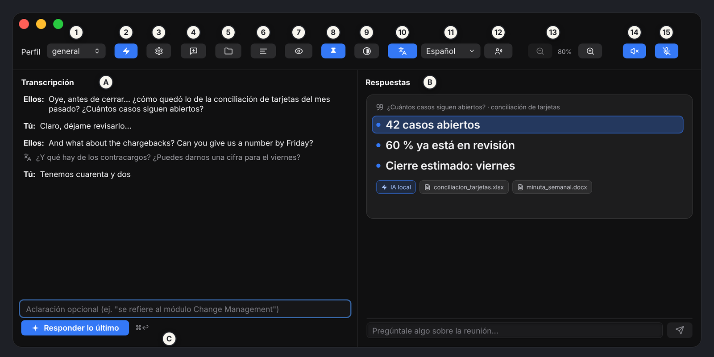
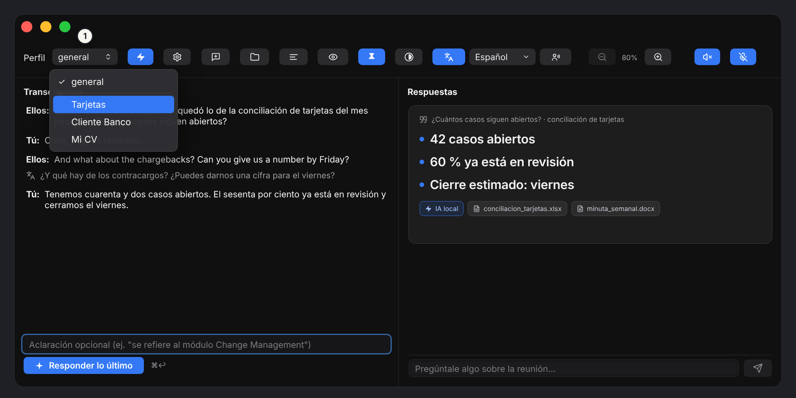
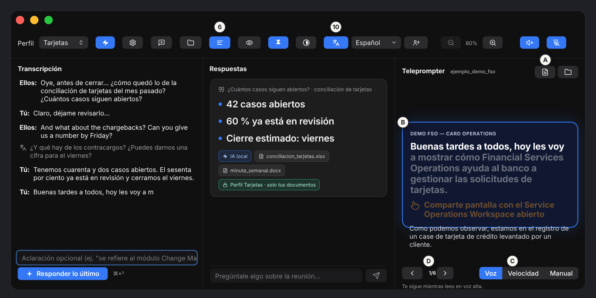

<div class="cover">

# NextHelp

## User Manual

Your copilot for any meeting · Version 1.0 · macOS (Apple silicon)

*by Zeedatik · [zeedatik.com](https://zeedatik.com)*

</div>

<div class="pagebreak"></div>

# 1. What NextHelp is

NextHelp is a Mac app that keeps you company during a meeting, a class or a call. **It listens, transcribes, translates and suggests what to say**, using information from your own documents.

At a glance:

1. **It listens** to two sources: what plays on your Mac (the other people on the call, which the app calls **"Them"**) and your microphone (**"You"**).
2. **It transcribes** live, on your Mac and without internet.
3. When someone asks you a question, you press **Answer the latest** and the AI proposes an answer, based on the documents in the **profile** you chose.

> By default, transcription and AI run on your Mac. If you choose a cloud AI provider, the text you send is processed by that provider.

> Button names in this manual are the ones shown when the app language is English (**Settings → General → App language**).


# 2. Requirements and installation

- A Mac with **Apple silicon (M1 or later)**. There is no Intel version.
- **macOS 15 or later** (macOS 26 recommended: better transcription and translation).
- 5–10 GB of free disk if you want local AI models.

**Install in four steps** (full guide in [INSTALL.md](https://github.com/zeedatik/NextHelp/blob/main/INSTALL.md)):

1. Download the `.dmg` from the [Releases page](https://github.com/zeedatik/NextHelp/releases/latest).
2. Open it and drag **NextHelp** into **Applications**.
3. Open **Terminal** and run this once:

   ```bash
   xattr -dr com.apple.quarantine /Applications/NextHelp.app
   ```

   This is needed because the app is not yet notarized by Apple. Without it, macOS only offers "Move to Trash" or "Done" and the app will not open. Do not move it to the Trash.
4. Open NextHelp from Applications.

## Updating NextHelp

1. Quit NextHelp (⌘Q).
2. Open the new `.dmg` and drag **NextHelp** into **Applications**, replacing the old app.
3. Run the `xattr` command above again and open the app.
4. Your profiles, documents and transcripts are kept (they live outside the app). If a profile shows as outdated, press **Reindex** (section 7).
5. macOS may ask for permissions again. If the "Them" audio does not work after updating, use **Settings → General → Resolve permissions conflict** (section 15).

# 3. First launch

**Terms and privacy.** The first time, you must read and accept the Terms of Use and the Privacy Notice. By accepting, you take responsibility for informing the people you transcribe and obtaining their consent.

**macOS permissions.** The app will ask for:

| Permission | What it is for |
|---|---|
| Microphone | Transcribing what you say. |
| Speech Recognition | Turning audio into text. |
| Screen & System Audio Recording | Hearing the other people on the call ("Them"). |

If you miss one, enable it in **System Settings → Privacy & Security** and reopen the app.

**Welcome assistant.** It checks your Mac (memory and free disk), recommends models and, if you accept, **installs Ollama** (the program that runs local models) and **downloads the recommended models**. You do not need the terminal. It can take several minutes depending on your connection: wait for it to finish before your first meeting. If you prefer a cloud service, choose **"I prefer to use a cloud provider"** and add your provider (see section 12).

When done you will see **"All set"**. You can repeat the assistant later from **Settings → Services → Repeat welcome**.

# 4. A tour of the window



The window has three areas: **A) Transcript** (what is said), **B) Answers** (what the AI suggests) and **C) the optional clarification field with the "Answer the latest" button**. The button bar is on top. A **blue** button means that feature is on.

| No. | Button | What it does |
|---|---|---|
| 1 | **Profile** | Chooses the group of documents used to answer (section 7). |
| 2 | **Fast / Reason** | Fast answers in a few seconds. Reason makes the model think before answering: more accurate, but it can take minutes. |
| 3 | **Settings** | Models, context window, voice, providers, services, profiles and memory. |
| 4 | **New meeting** | Saves the current transcript and starts a new meeting (new file, title and summary). |
| 5 | **Transcripts** | Opens the folder where each meeting's transcript is saved. |
| 6 | **Teleprompter** | Shows or hides the teleprompter (section 9). Use the same button to remove it. |
| 7 | **Visible / Hidden when sharing** | When set to "Hidden", this window does not appear when you share your screen (section 10). |
| 8 | **Always on top** | The window floats above other apps, also in full screen and on all desktops. |
| 9 | **Appearance** | Background and text transparency, text color and compact mode. |
| 10 | **Translate** | Translates live and puts the translation under each line (section 6). |
| 11 | **Language** | List of languages to translate to ("Translate to"). |
| 12 | **My phrases** | Also translates what you say. By default only what "Them" say is translated. |
| 13 | **− 80 % +** | Shrinks or enlarges the whole app: text, buttons and window (⌘− and ⌘+). |
| 14 | **Mute internal audio** | Stops transcribing what plays on the Mac ("Them"). |
| 15 | **Mute my mic** | Stops transcribing what you say. |

Buttons may show only their icon (compact mode). Hover over one to see its description.

**Meeting bar.** Next to the buttons above there are four controls for the meeting in progress (details in section 8):

| Control | What it does |
|---|---|
| **Meeting title** | A field to name the meeting. It renames the autosave file. |
| **Summary** | Generates a short summary of the meeting so far, with decisions and action items. |
| **Save as…** | Saves the transcript as `.txt`, `.md` or `.json`. |
| **Open recent** | Opens a saved transcript in read-only mode. |

**Cloud data indicator.** If any cloud AI provider is active, a permanent indicator appears in the top bar to remind you that the transcript and the needed document fragments leave your Mac. If everything is local, it does not appear.

# 5. Transcript and answers

## The transcript

- **"Them"** lines come from your Mac's audio. **"You"** lines come from your microphone.
- A line in *italics* is not confirmed yet: wait until it stops being italic before correcting it.
- To **correct** a line, click its pencil, edit the text and confirm with **Enter** (or **Esc** to cancel). It is marked "Edited by hand".
- Click one or more lines to **select** them. **Delete** removes them from the transcript and **Clear** clears the selection.
- **The transcript follows you.** While you are at the bottom, the view moves by itself with the latest speech. If you scroll up to read something, it stays where you are and the arrow next to the "Transcript" title lights up with the number of new lines. Press it to go back to the latest line and keep following.
- If system audio is interrupted (for example when a monitor is disconnected or the Mac wakes from sleep), you will see "System audio interrupted, reconnecting…" and the app reconnects by itself.
- Each meeting is saved automatically in `~/Documents/MeetingAssistant/Transcripciones/` (section 8). The file also reflects your corrections and deletions. **New meeting** closes the current one and starts another.

## Asking for an answer

| I want to... | Do this |
|---|---|
| Answer the latest thing "Them" said | Press **Answer the latest** or use **⌘↩**. |
| Answer a specific part | Select one or more lines and press **Answer selection**. It answers those lines, even if they are yours. |
| Give the AI context | Type an **optional clarification** (for example "it refers to the Change Management module"). It helps search your documents better. |
| Ask a free question | Type at the bottom in "Ask something about the meeting…". The AI uses the meeting summary, the key facts and what was said most recently, plus the profile's documents. |
| A more reasoned answer | Press **Go deeper** on a fast answer card: a new card labeled "reasoned" appears and the first one does not change. |
| A more developed version in the same thread | Press **Expand**: it adds a version with more points and examples to the same thread. |
| Ask about one specific thread | Press **Selected / Ask** on that thread; what you type below is asked about it. |
| Stop an answer | Press **Stop**. |

Each answer shows which **sources** (documents) it came from. In **Reason** mode you can open **Show reasoning**.

**How ⌘↩ answers.** It always answers first in **Fast** mode so you see something right away. If your setting is **Reason**, once the fast answer finishes the app starts the reasoned card below by itself.

**When the latest line is not a question.** NextHelp does not stay blank: if "Them" make a statement or a request, it suggests what to say. If you select something very short like "yes, exactly", it uses the earlier context for its best guess and asks you one short clarifying question.

**Text that appears instantly.** The answer starts showing as soon as the first piece arrives and refreshes smoothly. The **Go deeper** button is disabled while another answer is in progress.

# 6. Translation

Translation **runs on your Mac with the macOS translator, without internet**.

1. Press the **Translate** button (10). It turns blue and the translation appears under each line.
2. To choose the language, open the language list next to the button (11). If a language is missing its pack (⬇︎), macOS asks permission to download it **just once**. A ✓ means it is ready, and "(vía modelo)" means it will be translated with the AI model.
3. To turn it off, press **Translate** again.

**Important: by default only what "Them" say is translated.** If you also want to see the translation of what you say, press the **My phrases** button (12), next to the language list. It turns blue when on; press it again to turn it off.

If the translation is going to use the AI model, it waits while the AI is answering a question of yours, so they do not compete for your Mac's memory.

If you see "Could not translate", check **System Settings → General → Language & Region → Translation Languages**.

# 7. Profiles and documents

## What a profile is

A **profile** is a group of documents about a topic: for example your CV and projects, the material of a course, or a client's manuals. You switch profiles with the **Profile** selector (1) and the AI answers using that material.

| Profile | How it answers |
|---|---|
| **general** | Documents only **support**. If there are none or they do not help, the AI still answers from its own knowledge and the transcript. |
| **Any profile you create** | Strict mode: the AI answers **only from what your documents** in that profile say. If the profile has no documents, the app tells you. |



## Creating a profile and adding documents

1. Open **Settings → Profiles**.
2. Press **New profile** and type a name. Only lowercase letters without accents, numbers and underscore (`_`) are allowed; anything else becomes `_`. Examples: `my_cv`, `backend_interview`, `physics_2`.
3. Select the profile and press **Add documents…**. You can pick several at once.
4. Wait for indexing to finish (the app shows progress and you can **Cancel indexing**). You will see how many fragments each document has and how many were indexed or unchanged.
5. Close Settings, choose the profile in the selector and start asking.

## Supported documents

| Format | Notes |
|---|---|
| **`.md` (Markdown)** | **The best format.** `#` and `##` headings are respected as sections. |
| **`.txt`** | Plain text. |
| **`.pdf`** | Must have **selectable text**. It is read page by page. |
| **`.docx`** (Word) | Paragraphs, heading styles and simple tables. |
| **`.pptx`** (PowerPoint) | The text of each slide. |
| **`.xlsx`** (Excel) | Each sheet is a section; each row is saved as `column: value`. |
| **`.csv`, `.json`** | Each CSV row as `column: value`; JSON is flattened to `path: value`. |
| `.rtf`, `.doc` (old), `.html` | Text only. In HTML, scripts, styles and external resources are ignored. |

**Not supported (yet):** scanned PDFs or images only (they need OCR), password-protected PDFs, encrypted Word or Excel files, standalone images, audio and video. If your PDF is a scan, convert it to a PDF with text first or copy it into a `.md`. Complex PDF tables are read as text but lose their structure.

**Limits (for safety and performance):** 20 MB per file, 500 pages, slides or sheets, and 1,500 fragments per document. If something exceeds them, the app tells you with a clear message and does not index garbage. If you add a file again and it did not change, it is skipped; if it changed, only the modified fragments are recalculated.

## Notices about your documents

When indexing, the app checks each document and, in **Settings → Profiles → Notices about your documents**, tells you how to improve it. It warns you if a document is very short (under 500 characters), has no headings, is too large, has many unreadable characters, or repeats the name of another document in the same profile.

## Writing good documents

The app splits each document by **sections and paragraphs** and, for each question, looks for the most similar fragments. These rules help a lot:

1. **Key facts first:** price, who it is for and what makes it different, in the first lines.
2. **Descriptive headings with the product or topic name** ("NextHelp Pro pricing", not "Pricing").
3. **Sections that make sense on their own**, about 150 to 350 words.
4. **Consistent names:** repeat "NextHelp" instead of alternating "the assistant" or "the tool".
5. **A glossary** of acronyms and internal terms.
6. **Frequently asked questions** with the question as the other person would ask it and a short answer.
7. **Avoid wide tables:** prefer lists ("Plan: Pro; Price: 20 USD").
8. **Title, source and date** at the top of each document.
9. **One topic per file**, rather than one giant file.
10. **No filler:** remove covers, indexes and legal notices that add no answers.

For **Fast** answers, short cards work best (one fact, one figure, a sentence ready to say out loud). For **Reason**, longer sections, comparisons and arguments with nuance help.

In **Settings → Profiles** there is a **View ideal template** button with a sample document ready to copy with **Copy template**. A simple example for interviews:

```markdown
# Jane Doe — CV

Source: my CV · Date: 2026-10-01

## Project: Study room booking
Web app to book study rooms.
Technologies: Python, FastAPI and PostgreSQL. I cut booking time
from 5 minutes to 30 seconds.

## Project: Inventory dashboard
Dashboard for a small store. Built with React and a REST API.
My role: design and development. Result: used daily by 4 employees.
```

## Maintaining profiles

- **Reindex:** if you change the embeddings model (Settings → Models), profiles are marked as outdated. Press **Reindex** to search them again.
- **Show documents folder in Finder:** the app keeps a copy of each document in `~/Library/Application Support/NextHelp/Perfiles/<profile>/`. Your original files are **not touched**.
- **Delete profile:** removes its index and copies; your original files stay intact.
- If you use a cloud provider with a profile, the parts of your documents that are needed **leave your Mac** and go to that service.

# 8. Summary, saving and memory

## Meeting title

Type a name in the **Meeting title** field and confirm with **Return**. The autosave file is renamed; no second file is created. If you type nothing, after a little conversation the app proposes a short title with the fast model; once you type one yourself, it no longer changes it.

## Meeting summary

Press **Summary** to get a short summary with **decisions and action items** up to that moment. It appears as a card in Answers. Each time you press it, the summary is updated with what is new, without starting over; if nothing new was said, the app tells you. Use **Copy summary** to take it to the clipboard. If very little has been said, it tells you there is not enough to summarize yet.

## Save as… and Open recent

- **Autosave.** Each meeting is saved by itself as `YYYY-MM-DD_HH-mm · Title.txt` (or `reunion-YYYY-MM-DD_HH-mm.txt` if it has no title) next to a `.json` with the complete meeting, which is used to restore it.
- **Save as…** exports the transcript as `.txt`, `.md` or `.json` wherever you choose.
- **Open recent** lists your saved transcripts. They open **read-only**; if they have a `.json`, the **Restore** button loads them into the main window (the current meeting is saved first).

## Memory across meetings

NextHelp summarizes the meeting **in the background** and keeps **short facts** (decisions, action items, people, figures). With that it answers with more context without rereading the whole transcript and can remember earlier meetings. Only summaries and facts are stored, **never the verbatim transcript**. Automatic summaries may contain mistakes.

In **Settings → Memory** you can:

- Turn **Remember across meetings** on or off (it is on by default). When off, memory only lives during the current meeting and nothing is saved.
- See the **saved facts** and **saved summaries**, and **delete** each one.
- **Export…** the memory to a `.json` file.
- **Delete all memory** (this cannot be undone; saved transcripts are not touched).

If you use a cloud provider, the summary and relevant facts travel to that provider as part of the question (only if you accepted its privacy notice). Memory is stored in `~/Library/Application Support/NextHelp/memory.sqlite`.

# 9. Teleprompter

The teleprompter helps you present a demo or talk without losing your place.



1. Press **Teleprompter** (button 6) to show it. **To remove it, press the same button again.**
2. In the teleprompter column, press the document button (**A**) to **open a script** `.md` or `.txt`, or the folder button to open the scripts folder (`~/Documents/MeetingAssistant/Guiones/`).
3. The card (**B**) shows the **current step** and, below it, the next one. The counter (**D**) shows "Step 1 of 6" and the arrows change step.
4. Choose the **mode** (**C**):

| Mode | How it advances |
|---|---|
| **Voice** | Follows you as you read aloud: it advances when you say the **start** and the **end** of the step. |
| **Speed** | Scrolls by itself at the words per minute you choose. |
| **Manual** | You move it with the arrows or by tapping a step. |

## Script format

A text or Markdown file with these rules:

- A **normal line** is what you **say**. It is used to detect your progress in Voice mode.
- A line between **double asterisks** (`**like this**`) is what you **do on screen** (an action).
- A **blank line** separates one step from the next.
- A line starting with `#` is a section **title** (optional).

```markdown
# Product demo

Good afternoon everyone, today I will show how the reports module works.
**Share your screen with the dashboard open**

Here we see the monthly sales summary, by region.
**Point at the bar chart**
```

# 10. Screen sharing and window

- **Visible / Hidden when sharing (7).** When set to "Hidden", the NextHelp window does not appear in what others see when you share your screen, but you still see it. **Always test it with a practice call before an important meeting**, because each video-call app captures the screen in its own way.
- **Always on top (8).** Keeps the window visible above other apps.
- **Appearance (9).** Adjusts background and text transparency, text color (Auto, White or Black) and **compact mode**, which leaves only icons for a much shorter, narrower window. To save energy, the automatic text-color adjustment to the background pauses when the window is not visible.
- **Zoom (13).** Makes the whole app bigger or smaller (⌘+ and ⌘−).

# 11. Voice and languages

It is in **Settings → Voice**. Everything is recognized on your Mac, without internet.

- **Voice language:** *Spanish + English* (recommended: it uses two recognizers and picks, word by word, the more confident one; good for Spanish sentences with English terms), *Spanish only* or *English only*.
- **Language switching:** *Conservative* (favors the language that dominates the sentence), *Normal* or *Sensitive* (detects any word in another language).
- **Custom vocabulary:** names, acronyms and terms that come out wrong; one per line or comma-separated. Applying it restarts the transcription for a few seconds.
- **App language:** in **Settings → General** (Spanish, English, Simplified Chinese, Hindi and French). It does not change the language you are transcribed in or the one you translate to.

If macOS does not have offline dictation for the language, turn it on in **System Settings → Keyboard → Dictation**.

# 12. Models, context, providers and performance

All of this is changed in **Settings**, and the initial setup (**Balanced**) works well on almost any Mac.

## Models

Choose which model each function uses: fast answers, reasoning and **embeddings** (document search; required to use profiles with documents). You can **install models** from the Ollama library; the app marks the ones recommended for your Mac. Changing the embeddings model requires reindexing profiles.

## Context

How much the AI can read at once (transcript, documents and question). More context reads more of the meeting but uses more memory:

| Option | Reads about | Recommendation |
|---|---|---|
| Light | 4 min of meeting | Very fast, low memory. |
| **Balanced** (default) | 8 min | Balance for almost any Mac. |
| Wide | 16 min | Uses more memory. |
| Very wide | 30 min | From 16 GB of RAM. |
| Maximum | 1 hour | Only with 32 GB of RAM or more. |

With the meeting memory (section 8), the older part is not lost: it stays in the summary and in the saved facts, and the AI also receives what was said most recently. If the meeting does not fit, the oldest part is trimmed and the app tells you next to the answer.

**Reason uses the same window as Fast**. This way, switching between modes does not make Ollama reload the model and avoids waits of several seconds. The reasoning shares that space with the answer.

## Performance and your Mac's memory

NextHelp adjusts how long it keeps models loaded according to your Mac's RAM, so it does not overload it while you use other apps:

| Your Mac | Models loaded at once | Time loaded while idle | Automatic summary |
|---|---|---|---|
| 8 GB or less | 1 | 5 min | Every ~3,000 new tokens or ~10 min |
| 9 to 15 GB | 2 | 15 min | Every ~2,000 new tokens or ~7 min |
| 16 GB or more | As many as Ollama decides (up to 3) | 30 min | Every ~1,500 new tokens or ~5 min |

In addition:

- The app **preloads** the fast model at startup so the first answer comes out sooner. On 8 GB Macs it does not preload the embeddings model, so it does not push the fast model out of memory.
- If you see **"Loading the model into memory… the first answer takes longer"**, the model is loading; later answers will be faster.
- The automatic summary is **postponed** if a question is in progress, and also if macOS reports low memory or the Mac is running very hot. A question from you always has priority.
- Flash attention is always on to use less memory. In **Services** you can save even more with the **compressed KV cache**.
- If reasoning runs too long without producing text, the app cuts it and writes the answer from what it had thought so far.

## Providers

A provider is the service that runs the models. **Ollama** (local) is the default and nothing leaves your Mac. You can also add an **OpenAI-compatible** one (OpenAI, OpenRouter, Groq, LM Studio and others) or **Anthropic**, with your own API key. The key is stored in the macOS **Keychain**.

With a cloud provider, what you ask and the needed parts of the transcript and your documents **leave your Mac** and go to that service. That is why:

- **Data-sharing notice.** A remote provider stays off until you accept, once, the notice of which data will leave your Mac. If you change its address, the notice is asked again. You can review it with **Review notice…**.
- **Safe addresses.** Addresses must use `https`. `http` is allowed only to your own computer or to a device on your **local network**, and in that case the app asks you to **confirm** that you trust that network, because the key and your conversations would travel unencrypted. The key is never sent over `http` to an Internet server.

## Services

Shows Ollama's status (address, port, version), lets you restart it and see its log, save memory with the compressed KV cache, and **Copy diagnostics** to ask for support. NextHelp only uses an Ollama with the **official signature**: if it finds another program on the usual port, it does not use it and starts its own; if the installed Ollama is not the official one, it asks you to install the official version from here.

# 13. Keyboard shortcuts

| Shortcut | Action |
|---|---|
| **⌘↩** | Answer the last thing. |
| **⌘ +** / **⌘ −** | Enlarge / shrink the whole app. |
| **Enter** / **Esc** | Save / cancel a line correction. |

# 14. Use cases

- **Interview (for practice).** Create the profile `my_cv` with your CV and projects in `.md` or `.docx`. Simulate the interview with a friend, and when they ask about a project, press **Answer the latest**: it proposes an answer based on your own CV. Use it only where it is allowed.
- **Meeting in another language.** Turn on **Translate**, choose the language and read the translation under each line.
- **Online class.** Create one profile per course with your notes and ask to review what the teacher just said. At the end, press **Summary** and **Save as…**.
- **You lost the thread.** Press **Summary** or use the free question ("what has been agreed so far?") to catch up in seconds.
- **Recurring meetings.** With memory on, ask "what was left pending from the last meeting?" and NextHelp remembers earlier decisions and action items.
- **Presentation or demo.** Write your script, open it in the teleprompter in **Voice** mode and leave the button on **Hidden when sharing**.

# 15. Troubleshooting

| Problem | What to do |
|---|---|
| macOS only offers "Move to Trash" or "Done" and the app will not open. | Run `xattr -dr com.apple.quarantine /Applications/NextHelp.app` in Terminal and open it again. Needed once for each version you install. |
| It says the app "is damaged". | Repeat the command above and make sure NextHelp is in Applications, not inside the DMG. |
| It does not transcribe what others say. | Check the **Screen & System Audio Recording** permission and that **Mute internal audio** (14) is not on. |
| After updating, the "Them" audio does not work or hangs. | macOS ties permissions to the app's signature and may be using those of another version. Go to **Settings → General → Resolve permissions conflict** and press **Resolve and restart**: it removes the old copies from the macOS registry, deletes the saved permissions and reopens the app. macOS will ask for them again: accept them. Your profiles, documents and transcripts are not touched. |
| I see "System audio interrupted, reconnecting…". | Normal if you changed displays or the Mac woke from sleep. The app retries by itself; if it says "Could not reconnect", use **Mute internal audio** and turn it back on. |
| It does not transcribe what I say. | Check the **Microphone** permission and that **Mute my mic** (15) is not on. |
| It does not translate. | Check System Settings → General → Language & Region → Translation Languages, and download the language from the language list (11). |
| Only what others say is translated. | That is normal. Turn on the **My phrases** button. |
| "The profile … has no indexed documents yet". | Add documents in Settings → Profiles, or switch to the **general** profile. |
| A profile's documents do not answer well. | Check **Notices about your documents**, reindex the profile and use files with real text and clear headings. |
| A document is not indexed. | The message gives the reason: unsupported format, over 20 MB, password-protected PDF or no text (a scan). Split it, remove the password, or convert it to a PDF with text or to `.md`. |
| Answers take too long. | Use **Fast** mode, lower the context window or choose a smaller model. The first answer after a while without using the app can take longer because the model has to load. |
| "You need to accept the privacy notice for …". | Go to Settings → Providers, press **Review notice…** and accept it, or go back to a local provider. |
| "Unencrypted connection on your local network". | It is a provider using `http` to a device on your network. Confirm it only if you trust that network, or switch to `https`. |
| Ollama does not respond. | Settings → Services → **Restart** and check the log. |
| "An Ollama was found … but its signature is not the official one". | NextHelp does not run an Ollama without the official signature. Install the official version from Settings → Services. |
| I want to send a report. | In **Settings → General** use **Report on GitHub** or **Email support**: they open a prepared message that you review and send. |

# 16. Where your things are stored

| What | Where |
|---|---|
| Transcripts (`.txt` and `.json`) | `~/Documents/MeetingAssistant/Transcripciones/` |
| Teleprompter scripts | `~/Documents/MeetingAssistant/Guiones/` |
| Profiles and document copies | `~/Library/Application Support/NextHelp/Perfiles/` |
| Document search index | `~/Library/Application Support/NextHelp/index.sqlite` |
| Memory across meetings | `~/Library/Application Support/NextHelp/memory.sqlite` |
| Ollama models | `~/.ollama` |

The app's data folder is private to your user. **Uninstall:** drag NextHelp to the Trash. To also remove its data, delete the folders in the table.

# 17. Privacy and responsible use

- By default, transcription and AI run on your Mac. Zeedatik does not receive your conversations or documents.
- If you connect a cloud AI provider, the text you send is processed by that provider under its own terms. NextHelp shows you a notice before turning it on and a permanent indicator while it is active.
- Memory stores summaries and facts, not the verbatim transcript, and you can delete it whenever you want.
- **Inform people and get their consent** before transcribing them, according to the law and your school's or company's rules.
- Respect the rules of the interview, exam or meeting where you use it.

The full texts are in [`legal/`](https://github.com/zeedatik/NextHelp/tree/main/legal) and in the **Privacy Notice** shown when you open the app.

# 18. Support

Something not working, or have an idea? Open an [Issue](https://github.com/zeedatik/NextHelp/issues) or write to soporte@zeedatik.com and include your macOS and NextHelp versions (Settings → General). For a diagnostic, use **Settings → Services → Copy diagnostics**.

---

© 2026 [Zeedatik](https://zeedatik.com). All rights reserved.
